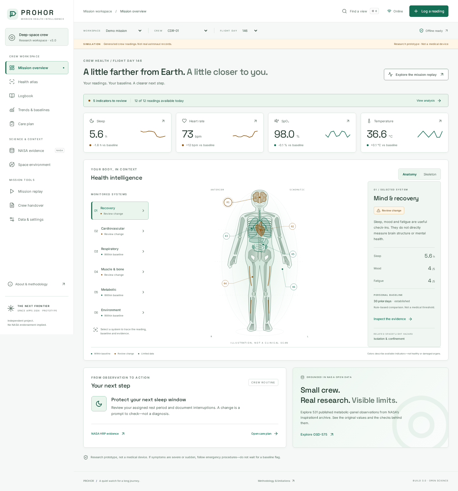
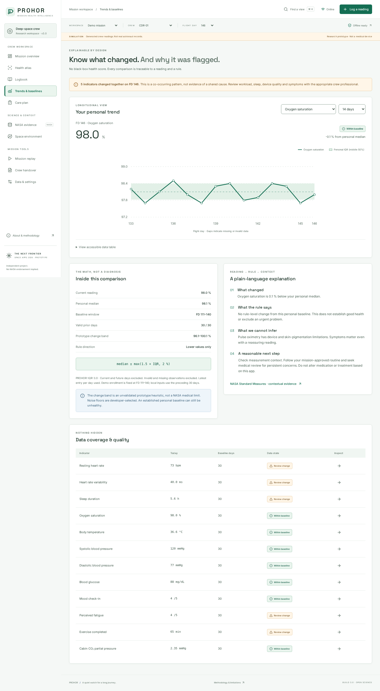
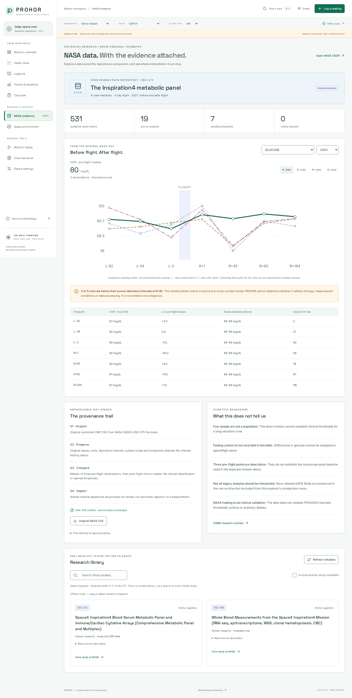

# PROHOR · Mission Health Intelligence

**A local-first health workspace for astronauts who have to be their own first responder.**

[](LICENSE)
[](package.json)
[](https://prohor-rho.vercel.app)
[](https://github.com/tufayelahmedsuhagcc-dotcom/Proho/actions/workflows/ci.yml)

**Live prototype:** [prohor-rho.vercel.app](https://prohor-rho.vercel.app) · **Source:** [github.com/tufayelahmedsuhagcc-dotcom/Proho](https://github.com/tufayelahmedsuhagcc-dotcom/Proho) · **Challenge:** [Create Health Monitoring Software for Astronauts on Space Missions](https://www.spaceappschallenge.org/2026/challenges/health-monitoring-software/) (2026 NASA Space Apps Challenge)



### In a hurry?

| If you have                 | Start here                                                                                                   |
| --------------------------- | ------------------------------------------------------------------------------------------------------------ |
| **30 seconds**              | The [live prototype](https://prohor-rho.vercel.app) — open it, press _Explore the mission replay_            |
| **2 minutes**               | [SUBMISSION.md](SUBMISSION.md) — what it is, how it maps to the judging criteria, and the demo path          |
| **5 minutes**               | [docs/METHODOLOGY.md](docs/METHODOLOGY.md) — the baseline rule, its floors, and what the numbers cannot mean |
| **A technical review**      | [docs/ARCHITECTURE.md](docs/ARCHITECTURE.md) → [docs/TEST-REPORT.md](docs/TEST-REPORT.md) → `npm test`       |
| **An accessibility review** | [docs/ACCESSIBILITY.md](docs/ACCESSIBILITY.md) — what was measured, and what was not                         |

---

## The problem

On a long-duration mission, a crew member cannot walk into a clinic. They record their own
readings, decide whether a number matters, and act — often with a delayed link to the ground.
Most "space health dashboards" answer that with an alarm colour. A colour is not a decision:
it hides which baseline was used, how many days of data existed, which rule fired, and what
the crew member should actually do next.

PROHOR answers the four questions a crew actually has:

1. **What did I measure?** — validated entry, units preserved, nothing silently imputed.
2. **How does it compare to _my_ normal?** — a personal baseline built from _distinct prior days_, with the window and sample count shown.
3. **How sure is this?** — data completeness, rule direction, and evidence exposed next to every flag.
4. **What do I do now?** — a conservative routine step, documented, and handed to a human for review.

## What it does

Eleven connected views. Nothing is a mock-up: every number below is computed in the browser
from the file or entry it claims to come from.

| View                    | Working behaviour                                                                                         |
| ----------------------- | --------------------------------------------------------------------------------------------------------- |
| **Mission overview**    | Day- and profile-specific calculations, missingness, sparklines, and one contextual next step             |
| **Health atlas**        | Interactive SVG anatomy and skeleton; six body systems, keyboard selection, explicit proxy limits         |
| **Logbook**             | Validated entry, optional daily check-in, unit preservation, filters, pagination, deletion, CSV export    |
| **Trends & baselines**  | Prior-day median/IQR, rule direction, coverage, source readings, and table alternatives to every chart    |
| **Care plan**           | Routine prompts tied to the flagged system; done/deferred state persisted per crew, day and mode          |
| **NASA evidence**       | The original OSD-575 CSV parsed in-browser, SHA-256 verified, four-subject comparison, source row numbers |
| **Space environment**   | Live NOAA planetary Kp feed with observation and retrieval times; cabin CO₂ stays a separate input        |
| **Mission replay**      | Deterministic six-day scenario with play/pause/reset — labelled simulation, never "live telemetry"        |
| **Crew handover**       | Review notes, text/JSON download, clipboard and print-to-PDF packet. No transmission                      |
| **Data & settings**     | Atomic CSV import, validated JSON restore, backup, erased-data confirmation, reduced motion               |
| **About & methodology** | Data boundaries, references, privacy, AI-assistance disclosure, scientific limitations                    |

### The design decision that matters

A baseline is only honest if you say what it is made of. PROHOR computes a **median and
interquartile range over the last 30 _distinct prior days_**, excluding the current day,
future days, invalid readings and missing values. It needs **7 days** before it will compare at
all, labels 21+ days _established_, and never borrows a baseline from another crew member or
another mode. A brand-new local workspace therefore reports **insufficient prior data** — never
a reassuring green.



## Four deliberately separate data contexts

Mixing these is how health demos become misleading. PROHOR keeps them visually and
computationally apart.

| Context                      | What it is                                                             | What it is not                                       |
| ---------------------------- | ---------------------------------------------------------------------- | ---------------------------------------------------- |
| **Simulation**               | 888 reproducible fixture records, 2 profiles, 37 days, 12 indicators   | Real astronaut or device data                        |
| **Local inputs**             | Measurements you type or import, in this browser only, units preserved | Encrypted, syncable or multi-user storage            |
| **Historical NASA research** | 531 submitted OSD-575 observations, 19 analytes, 4 coded subjects      | Your clinical thresholds                             |
| **Earth context**            | NOAA SWPC geomagnetic Kp observations                                  | Radiation dose, EVA clearance or a Mars hazard model |

## Quick start

```bash
npm ci
npm run dev      # http://localhost:5173  (dev server + public-data API)
```

Production build with the offline-capable service worker:

```bash
npm ci
npm run build
npm start        # http://localhost:3000 — wait for "Offline ready" before disconnecting
```

No Node? The repository also contains a prebuilt `web/` directory:

```bash
python3 -m http.server 3000 --directory web
```

Local analysis, imports, exports and the NASA archive work in that mode; public feeds fall back
to the bundled dated snapshots, which the interface labels as such.

> Do not open `web/index.html` by double-clicking — the app uses root-relative URLs and needs an
> HTTP server.

## Verification

```bash
npm run typecheck    # TypeScript, strict
npm test             # 127 unit + adapter tests
npm run build        # production build
npm run format:check # Prettier
```

Browser workflows (Playwright + axe-core) run against the production server:

```bash
python -m pip install -r requirements-test.txt
python -m playwright install chromium
python tests/e2e.py
python tests/browser_hardening.py
python tests/browser_sweep.py
python tests/white_theme.py
```

[TEST-REPORT.md](docs/TEST-REPORT.md) records what was executed, against which build, and the
limits of those results. Passing software tests does not validate clinical effectiveness or
certify accessibility.

## Project map

```text
src/
  compute/      Deterministic analysis engine, archive normalisation, feed validation
  data/         Signal catalog, references, routine prompts, synthetic fixture
  components/   Anatomy, charts, accessible dialogs, entry form
  lib/          Persistence, workspace state, feed hook
  pages/        Eleven workspace views
server/         Same-origin read-only public-data adapters and local servers
api/feeds.mjs   Serverless entry point for Vercel
public/data/    Original NASA bytes, hashes, normalised archive, dated snapshots
scripts/        Reproducible normalisation and offline-precache generation
tests/          Unit tests and executable browser workflows
web/            Included production build
docs/           Methodology, provenance, deployment, security, test report, screenshots
```

## Science and data

- **NASA OSDR OSD-575** (SpaceX Inspiration4 blood serum metabolic panel) — downloaded, hashed,
  parsed in the browser, recomputed and cited with source row numbers. See
  [DATA-PROVENANCE.md](docs/DATA-PROVENANCE.md).
- **NASA OSDR OSD-569** metadata for study context; animal metadata is kept separate from human
  comparisons.
- **NOAA SWPC planetary K-index** — live, validated, time-stamped, with dated fallback.
- **NASA Human Research Program** references for sleep, standard measures and the five hazards.

The archive has **four crew on one short flight**. It can illustrate a comparison; it cannot
establish long-mission medical thresholds, and the interface says so where it matters. See
[METHODOLOGY.md](docs/METHODOLOGY.md).



## What PROHOR deliberately does not do

No diagnosis, no treatment recommendation, no health score, no radiation-dose estimate, no
fitness-for-duty decision, no runtime language model, no fabricated live telemetry, no simulated
authentication, no trackers, no camera/microphone/location access. Local storage is **not
encrypted**; treat it as a single-user demonstration workspace and do not enter identifying
medical information.

## Documentation

| Document                                                   | Contents                                                            |
| ---------------------------------------------------------- | ------------------------------------------------------------------- |
| [SUBMISSION.md](SUBMISSION.md)                             | Judging brief: what this is, how it maps to the criteria, demo path |
| [docs/METHODOLOGY.md](docs/METHODOLOGY.md)                 | Baseline math, thresholds, units, direction rules, limitations      |
| [docs/DATA-PROVENANCE.md](docs/DATA-PROVENANCE.md)         | Where every byte came from and how to refresh it                    |
| [docs/DEPLOYMENT.md](docs/DEPLOYMENT.md)                   | Local, static, Node and Vercel deployment; offline behaviour        |
| [docs/TEST-REPORT.md](docs/TEST-REPORT.md)                 | Executed tests, scope and honest coverage gaps                      |
| [docs/SECURITY.md](docs/SECURITY.md)                       | Threat model, data handling, known limitations                      |
| [docs/DEMO-SCRIPT.md](docs/DEMO-SCRIPT.md)                 | 30-second video script and 7-slide deck outline                     |
| [docs/ARCHITECTURE.md](docs/ARCHITECTURE.md)               | Modules, data flow, trust boundaries, build pipeline                |
| [docs/ACCESSIBILITY.md](docs/ACCESSIBILITY.md)             | Implemented affordances, measured contrast, unverified gaps         |
| [docs/THIRD-PARTY-NOTICES.md](docs/THIRD-PARTY-NOTICES.md) | Library, font and dataset notices                                   |

## AI assistance

Development was AI-assisted (Arena.ai), and that is stated in the product itself under
_About → Privacy & attribution_. Repository contents were reviewed rather than trusted: data
provenance is hashed, the analysis engine is deterministic and unit-tested, and every executed
test is recorded. No runtime AI service receives user readings.

## Team

Built for the 2026 NASA Space Apps Challenge, **The Next Frontier** theme.
Team and contributors: see [SUBMISSION.md](SUBMISSION.md).

## Citation and contributing

Machine-readable metadata lives in [CITATION.cff](CITATION.cff), so GitHub offers a _Cite this
repository_ button. Contributions follow [CONTRIBUTING.md](CONTRIBUTING.md) and
[CODE_OF_CONDUCT.md](CODE_OF_CONDUCT.md).

## Licence

[MIT](LICENSE) for the PROHOR application source and original assets. Third-party libraries,
fonts and NASA/NOAA data retain their own terms — see
[THIRD-PARTY-NOTICES.md](docs/THIRD-PARTY-NOTICES.md).

**Independent project. Not NASA software. No NASA endorsement implied. Not a medical device.**
